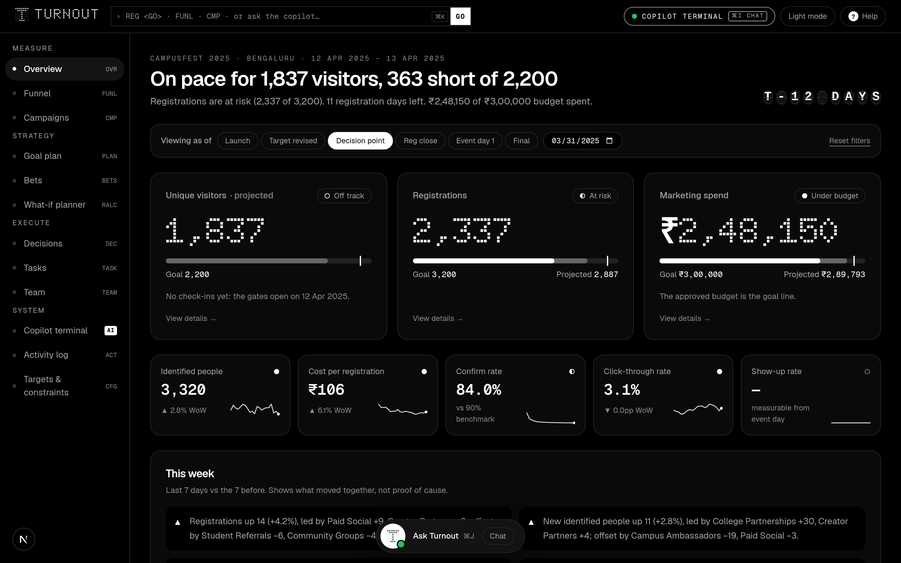
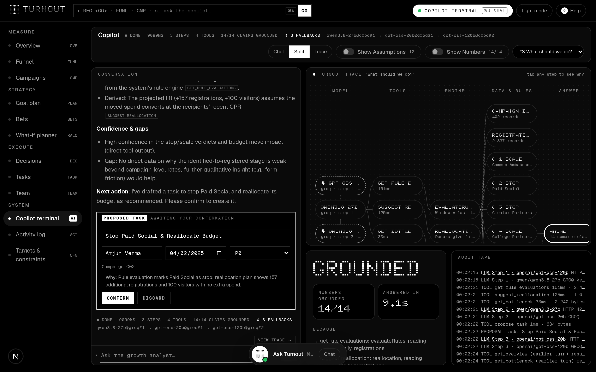
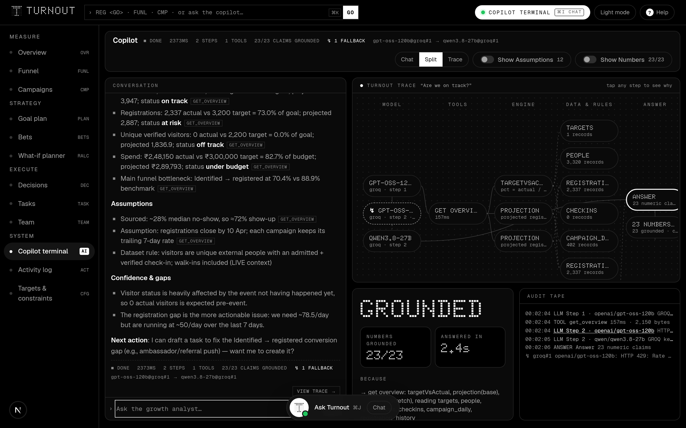
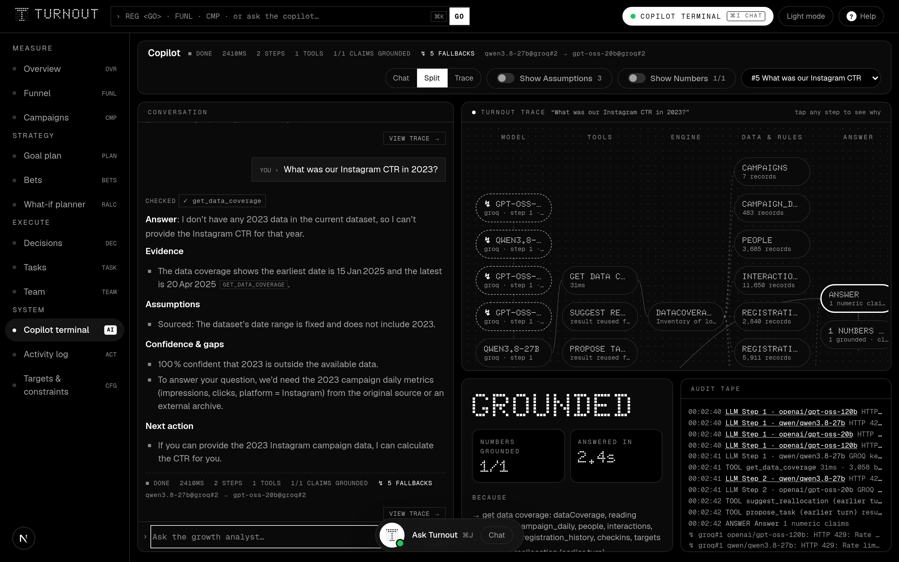

# TURNOUT

**One place to measure, diagnose, decide and manage attendee growth, with an AI analyst whose every number traces back to the data.**

RISA Growth APM assignment, Part 2 · **Challenge A: Attendee Growth** · city: **Bengaluru**

| | |
|---|---|
| **Live app** | _[Vercel URL: add after deploy]_ |
| **Passcode** | _[shared in the submission form]_ |
| **Demo video** | _[link]_ |
| **3-slide deck** | _[link to PDF]_ |
| **Full write-up (26 pages, with references)** | [README.pdf](README.pdf) |

**Why Bengaluru.** Bengaluru Urban has **1,148 colleges, the most of any district in India** (Pune 517, Hyderabad 465; AISHE 2023-24). The dataset's channels (ambassadors, college partnerships, clubs, referrals) work best where many campuses sit close together, and the college count gives the goal plan a sourced starting population instead of a guess.



### 60-second reviewer tour

1. Open the live link and enter the passcode. Press anywhere on the welcome screen. A 9-step tour runs on the first visit; **Skip** is on every step, and **Help** (top right) replays it.
2. On **Overview**, click the **Decision point** preset (31 Mar 2025). The headline reads *"On pace for 1,837 visitors, 363 short of 2,200"*.
3. Click the **Registrations** card to open its terminal-style drill-down, with the goal line and forecast cone.
4. Open **Funnel** (the bottleneck is highlighted), then **Bets** (five ranked strategies judged by early signals).
5. Open **Copilot terminal** and ask, in order:
   - *Are we on track?*
   - *Why?*
   - *What should we do?*
   - *Create a task for that*
   - *What was our Instagram CTR in 2023?*

   Click any step in the trace to see its inputs.
6. Press **⌘/Ctrl + J** and say *"take me to paid social"* (needs a microphone).

---

## 1. Demo workflow

All screenshots are from the running app, as of **31 Mar 2025**, in one copilot conversation.

| # | Ask or do | What happens |
|---|---|---|
| 1 | *Are we on track?* | Registrations **at risk**: 2,337 now, 2,887 projected vs 3,200. Visitors **off track**: 1,837 projected vs 2,200. Spend under budget. |
| 2 | *Why?* | Bottleneck: identified → registered is **70.4% vs the plan-implied 88.9%**. Weakest: Creator Partners, Community Groups, Paid Social. |
| 3 | *What should we do?* | **Stop** Paid Social (₹256 per registration, 14 days) and Creator Partners (₹134); the stop line is ₹110. Move **₹16,800** to the four cheapest campaigns: **+157 registrations, +100 visitors**. 14/14 numbers grounded. |
| 4 | *Create a task for that* | A **proposal card** appears. Nothing is written until **Confirm**; the task then shows in Tasks and in the Activity log as `copilot`. |
| 5 | Edit the data, ask again | Campaigns → Community Groups → Data: log ₹5,000 spend for 31 Mar. Its 14-day CPR goes from ₹25 to **₹103.1**; the verdict and the copilot's answer change on the next request. **Reset** restores the original data. |
| 6 | *What was our Instagram CTR in 2023?* | *"I don't have any 2023 data"*, with the real coverage (15 Jan–20 Apr 2025) and what data would be needed. |

| Step 3: recommendation, with the trace | Step 4: proposed, not created |
|---|---|
|  |  |

| Step 1: on track? | Step 6: honest about what it can't answer |
|---|---|
|  |  |

## 2. Research and data sources

Researched before building: fest attendance, the city's student base, ad costs, funnel and no-show benchmarks, and the free-tier limits of every service used. **Sponsor deal sizes were not researched**: they belong to Challenge B. Full notes, including where sources conflict: [docs/research.md](docs/research.md).

| Metric | Value | Source | Label |
|---|---|---|---|
| Colleges, Bengaluru Urban | 1,148 (most in India) | [AISHE 2023-24](https://www.dohe-education.gov.in/static/uploads/2026/07/8616f33dfee644ab6b87a2bd0658b18d.pdf) | Sourced |
| Bengaluru college students | ~8–10 lakh (8,30,000 used) | derived from AISHE | **Assumption** |
| Mood Indigo / Saarang / Oasis attendance | 1,50,000+ / 80,000+ / 8,000–10,000 | [Wikipedia](https://en.wikipedia.org/wiki/Mood_Indigo_(festival)), [IIT Madras](https://www.iitm.ac.in/happenings/press-releases-and-coverages/saarang-returns-iit-madras-8-12-jan-2026-new-experiences), [Wikipedia](https://en.wikipedia.org/wiki/Oasis_(festival)) | Sourced |
| Mood Indigo 2025 crowd crush | pre-registrations cancelled | [Careers360](https://news.careers360.com/iit-bombay-cancels-mood-indigo-pre-registrations-stops-entry-outsiders-crowd-chaos-seedhe-maut-concert-sonu-nigam-vicky-kaushal) | Sourced (why visitors are capped at capacity) |
| Meta CTR / CPC / CPL, India | 1.0–1.5% / ₹8–25 / ₹150–400 | [Owlclaw](https://owlclaw.com/benchmarks/meta-ads-benchmarks-india) | Sourced (vendor) |
| Instagram CPM, India | ₹45–350 | [Upgrowth](https://upgrowth.in/instagram-ads-pricing-india-2026/) | Sourced (vendor) |
| Free-event no-show (median) | ~28% → **show-up 72%** | [PheedLoop](https://pheedloop.com/blog/event-data-lab-report-5) | Sourced |
| Large free-event no-show | ~24% → **stretch show-up 76%** | [PheedLoop](https://pheedloop.com/blog/event-data-lab-report-5) | Sourced |
| Click → session / session → start / confirm | 70% / 15% / 90% | none found | **Assumption** |
| Sponsor deal sizes | not researched | — | Out of scope |

## 3. Assumptions

| Kind | What it is | How it's marked |
|---|---|---|
| **Original dataset** | The RISA workbook, byte-for-byte (SHA-256 checked). Every metric is computed from it. | No badge; **Reset** restores it |
| **Simulated** | Goal plan, 5 bets, decision log, 4 starter tasks, drafted by us. They change no dataset number. | `SIMULATED` badge |
| **User / copilot** | Anything created or edited in the app | `USER` / `COPILOT` badge, Activity log |
| **Assumptions** | Parameters the data can't give (below) | `Assumption` / `Sourced` label with link |

Sensitivity on 31 Mar (base: **1,837 visitors**), from the engine's scenario function:

| Assumption | Value | Why | If it moves |
|---|---|---|---|
| Show-up before the event | 72% (stretch 76%) | Sourced free-event median; the data's actual result was 77.0% | **Biggest lever: ~25.5 visitors per point.** 60% → 1,531; 50% → 1,276; 40% → 1,021 |
| Walk-ins | 5% of visitors | Actual was 125 / 2,050 = 6.1% | 0% → 1,745; 10% → 1,939 |
| Venue capacity | 2,500 | No field in the data | Not binding at base; caps the stretch plan (2,988 → 2,500) |
| Registration close | 11 Apr | Last registration seen 10 Apr | Each day ≈ +50 registrations |
| Rule thresholds | scale ≤ 0.8×, stop ≥ 1.5× portfolio CPR | No per-campaign cost targets in the source | Paid Social and Creator Partners stop at any multiple from 1.2× to 1.8× |
| Extra-spend efficiency | 2× recipient's CPR | Diminishing returns | Conservative: reallocation gains are understated |

## 4. Calculations

Full worked examples: [README.pdf §5](README.pdf) and [docs/calculations.md](docs/calculations.md). Every figure is checked against an independent pandas computation (`tests/engine.golden.test.ts`).

**Goal plan, bottom up** (the "how high can we aim?" answer):

```
identified_s = population_s × reach_s × identify_s        registered_s = identified_s × register_s
visitors     = min( capacity, Σ registered_s × confirm × show_up ÷ (1 − walk_in_share) )
```

| | Identified | Registered | Confirmed (× 0.89) | Attend | + Walk-ins | **Visitors** |
|---|---|---|---|---|---|---|
| **Base** | 3,928 | 3,108 | 2,766 | 1,992 (× 72%) | 105 | **2,097** |
| **Stretch** (reach × 1.25, register × 1.08) | 4,910 | 4,196 | 3,735 | 2,838 (× 76%) | 149 | 2,988 → **2,500** (capacity) |

The 2,200 goal sits between base and stretch: reachable, but not on base-case conversion.

**Projection from the data, 31 Mar:** 2,337 + 50.0/day × 11 days = **2,887 registrations** → × 83.95% confirmed × 72% show-up ÷ 0.95 = **1,837 visitors**. Stretch: 3,077 / 2,067.

**Rules (14-day CPR vs portfolio ₹73.58):** scale ≤ ₹58.86, stop ≥ ₹110.37 → Paid Social ₹256 and Creator Partners ₹134 **stop**; the other five **scale**.

**Final result (20 Apr):** identified 3,625 / 3,600 (achieved) · registrations 2,800 / 3,200 (87.5%, missed) · visitors 2,050 / 2,200 (93.2%, missed) · spend ₹2,74,000 / ₹3,00,000.

## 5. Prioritization: RICE for planning, rules for operating

RICE = Reach × Impact × Confidence ÷ Effort.

| # | Bet | Reach | I | C | E | **RICE** | Budget |
|---|---|---|---|---|---|---|---|
| 1 | Campus ambassador network | 40,000 | 2 | 0.8 | 6 | **10,667** | ₹60,000 |
| 2 | College club group sign-ups | 25,000 | 2 | 0.8 | 4 | **10,000** | ₹40,000 |
| 3 | Bring-3-friends referrals | 15,000 | 2 | 0.7 | 3 | **7,000** | ₹25,000 |
| 4 | Creator-led reels | 80,000 | 1 | 0.4 | 5 | **6,400** | ₹60,000 |
| 5 | Paid social retargeting | 1,20,000 | 0.5 | 0.4 | 4 | **6,000** | ₹95,000 |

Once campaigns run, evidence replaces estimates: the CPR rules. The two frameworks agree, because the two lowest-RICE bets are the two campaigns the rules later **stop**.

**Dropped:**
- **ICE:** no reach term, and reach is what differs most between peer and media channels.
- **MoSCoW and Kano:** they don't rank within a category.
- **Many-criteria scoring:** more knobs than evidence.
- **Cost per visitor as the daily metric:** it only exists after the event.

## 6. Product and architecture

| Module | Screens | What it does |
|---|---|---|
| **Measure** | Overview, 8 KPI terminals, Funnel, Campaigns | Goal vs actual vs projection; two-layer funnel; an **as-of** time machine (any day, 15 Jan – 20 Apr 2025) |
| **Diagnose** | Funnel, "This week", Campaign detail | Bottleneck stage and weakest campaigns; weekly drivers (association, not cause) |
| **Decide** | Campaigns, What-if planner, Goal plan, Bets | Scale / keep / change / stop; reallocation; scenarios; ranked bets with early signals |
| **Manage** | Tasks, Decisions, Team, Activity, Targets | Owners and due dates; decision outcomes 14 days later; workload; change log; reset |
| **Ask** | Copilot terminal, chat (⌘I), voice (⌘J) | Grounded answers with traces; proposals that wait for a yes; navigation by voice |

```
Browser ─ pages · copilot terminal · voice
   │  Server Components (reads) · Server Actions (writes) · /api/chat (stream) · /api/assistant/*
   ▼
Next.js 16 on Vercel
   ├─ lib/server/views.ts       read models, built only from engine results
   ├─ lib/server/mutations.ts   the one write path: Zod → write → activity log → bump data_version
   ├─ lib/analytics/*           PURE engine: snapshot, funnel, projection, bottleneck, rules, reallocation, strategy
   └─ lib/copilot/*             tools → engine · provider chain · trace recorder · claim grounding
   ▼
MongoDB Atlas M0 ─ source tables (+ baseline_* for reset) · tasks · bets · decisions · goal_model · activity · settings · meta
```

**How a change reaches the analytics:** every write bumps `meta.data_version`. Each request reads only that counter and reloads the dataset when it has changed, so pages, the API and the copilot all recompute from the same data. Cold start is ~1.5 s on M0; warm pages take 0.06–0.8 s.

## 7. AI chatbot design

- **Grounded:** 24 tools call the same engine as the screens. A sandboxed `calculate` tool does all arithmetic. Every number in an answer is matched against tool output; unmatched numbers are flagged **UNSUPPORTED**, and the verdict panel says GROUNDED or CHECK.
- **Confirm before writing:** the `propose_*` tools only return drafts. **Confirm** uses the screens' write path with `actor: "copilot"`. The voice assistant asks "Shall I…?" and acts only on a clear yes.
- **Uncertainty:** before saying the data can't answer, it must call `get_data_coverage`. Answers separate evidence, labelled assumptions and confidence, and say association, not cause.
- **Follow-ups:** routing uses the last two user messages, and ambiguous names return candidates.
- **Providers:** Groq first (`gpt-oss-120b` → `qwen3.8-27b` → `gpt-oss-20b`, two keys), then Gemini `3.8-flash` → `3.5-flash`. Fallback happens per step, and every attempt shows in the trace.
- **Trace:** recorded on the server from what actually ran. It shows Model → Tools → Engine → Data & rules → Answer, and every step is clickable.
- **Voice (Gemini Live):** the same tools, plus screen tools (navigate, read the screen, show details). The browser gets a single-use token, so the key stays on the server.
- **Limits:**
  - Free-tier rate limits cause fallbacks.
  - Data answers take ~5–13 s.
  - Grounding checks numbers, not reasoning.
  - A provider failure mid-stream isn't retried.

## 8. Testing

| What | Result |
|---|---|
| `npm test`: unit and golden tests (edge cases, pandas-checked engine, strategy engine, grounding, routing) | **60 / 60 pass** |
| `npm run eval`: 30 copilot questions in 11 categories, expected values computed live | **29 / 30 (96.7%)**; 172 / 193 numbers grounded (89.1%). Full table: [docs/eval-results.md](docs/eval-results.md) |
| `scripts/onboarding-e2e.mjs`: welcome → tour → help → skip, in real Chrome | pass |
| `scripts/assistant/voice-e2e.mjs`: voice with a simulated mic: navigate, ask, propose, "no" | 5 / 5 |
| By hand | worked examples vs pandas; the data-change loop (C07 CPR ₹25 → ₹103.1); every screen on 3 dates; provider fallbacks; both themes; reset |

The first eval scored 23/30; its failures led to four fixes. The remaining failure is ambiguity: *"the partners campaign"* was answered for one campaign instead of asking which.

## 9. Tools used

| Tool | Plan |
|---|---|
| Next.js 16.4 · React 19 · TypeScript | open source |
| Vercel | **Hobby (free)** |
| MongoDB Atlas | **M0 (free)** |
| Groq | **free tier**, 2 keys |
| Google AI Studio: Gemini 3.8 / 3.5 Flash, Gemini Live | **free tier** |
| Vercel AI SDK 7 · Zod 4 · mathjs · Tailwind 4 · React Flow + dagre | open source |
| React Bits (13 components) · Doto & Geist fonts | MIT + Commons Clause · SIL OFL |
| Vitest · Playwright · TeX Live (Docker) | open source |
| Claude Code (Anthropic) | _[plan]_, implementation pair |

**Reused, modified and verified:**
- **Reused:** the Next.js scaffold, React Bits, React Flow, dagre and the fonts.
- **Modified:** every React Bits component, restyled monochrome, with a reduced-motion fallback.
- **Written:** the engine, the write path, the copilot (tools, router, provider chain, trace, grounding), the voice assistant, all pages and charts, and the tests.
- **Verified:** the engine against pandas, the eval with live expected values, the data-change loop, and voice and onboarding in a real browser.

## 10. Setup

```bash
git clone <repo> && cd turnout
npm install                  # Node 22+
cp .env.example .env         # see below
npm run seed                 # import data/original (checks SHA-256)
npm run seed:strategy        # goal plan, bets, decisions (simulated)
npm run verify-seed          # headline numbers straight from MongoDB
npm run dev                  # http://localhost:3000
```

| Variable | Purpose |
|---|---|
| `MONGODB_URI`, `MONGODB_DB` | Atlas connection, database name |
| `GROQ_API_KEY`, `GROQ_API_KEY2` | primary models |
| `GOOGLE_GENERATIVE_AI_API_KEY`, `GOOGLE_API_KEY_2` | Gemini fallback |
| `ASSISTANT_GEMINI_API_KEY` | optional key for voice |
| `ADMIN_TOKEN` | protects seed / reset endpoints |
| `APP_PASSCODE` | optional demo passcode |

- **Reset to the original data:** use any of these:
  - Targets & constraints → **Reset**;
  - `npm run seed -- --reset`;
  - `POST /api/admin/reset` with `Authorization: Bearer $ADMIN_TOKEN`.
- **Deploy:**
  1. Push to GitHub, then import the repo in Vercel and add the variables.
  2. Set Node to 22, and the Functions region to the one nearest the Atlas cluster.
  3. In Atlas, allow `0.0.0.0/0`.
  4. On a fresh database, call `POST /api/admin/seed` once.
- **Rebuild README.pdf:** `./paper/build.sh` (needs the `texlive/texlive` Docker image).

## 11. Known limitations and next steps

- **Simulated strategy content.** The goal plan, bets and decisions are our drafts (labelled). Decision outcomes are 14-day associations, not causal estimates.
- **Show-up before the event** is a sourced benchmark, and it is also the biggest sensitivity.
- **Free-tier limits** cause fallbacks; a mid-stream provider failure isn't retried.
- **Latency:** data answers take ~5–13 s (chat) and ~13 s (voice), against 0.06–0.8 s for pages.
- **Grounding is numeric:** it catches invented numbers, not wrong reasoning.
- **Not built:** Challenge B (sponsorship).
- **Next:**
  - answers under 3 s;
  - persistent chat history;
  - per-campaign budget plans;
  - a cost-per-visitor rule after the event;
  - an eval set written by someone other than the builder.

## 12. Decisions I made

| Decision | Trade-off |
|---|---|
| **Challenge A over B** | The dataset is a complete person-level attendee history, so this could be built on real numbers end to end. Cost: no sponsor pipeline. |
| **Propose, never auto-execute** | The team sees exactly what will change and owns the call. Cost: one click per action. |
| **One engine for screens, API and copilot** | The chatbot can't contradict the dashboard. Cost: each new question type needs an engine function. |
| **Tools + calculator, not data in the prompt** | Exact arithmetic, traceable numbers, fits free-tier limits. Cost: slower multi-step answers. |
| **As-of replay, not "today"** | Reviewers can see the 31 March decision as it looked then, with no look-ahead. Cost: every query carries a date. |

## 13. Ownership: how I decided, tested, and what's still weak

- **Decided:** research first, written down with sources and conflicts ([research](docs/research.md)). Every decision is logged with its date and reason ([decisions](docs/decisions.md)). The dataset was profiled before any design ([dataset](docs/dataset.md)), so its 11 traps became tested engine rules.
- **Tested:** in this order:
  1. independent numbers (pandas vs TypeScript);
  2. edge cases;
  3. the AI, against answers computed live;
  4. the product, in a real browser.

  Failures changed the product: 23/30 → four fixes → 29/30, and the voice browser test found a turn-taking race, which was fixed.
- **Still weak:**
  - **The eval set:** I wrote all 30 questions myself, so it is a smoke test, not a benchmark.
  - **Ungrounded numbers:** about 1 in 10 numbers isn't grounded. These are flagged, not blocked.
  - **Voice:** it was tested with a simulated mic, not with real speech in noisy rooms.
  - **Strategy inputs:** these are my planning assumptions, and the team's own estimates should replace them.
  - **Latency:** this is the main gap.

---

Docs: [research](docs/research.md) · [dataset profile](docs/dataset.md) · [calculations](docs/calculations.md) · [eval results](docs/eval-results.md) · [decisions log](docs/decisions.md) · [diagram prompts](docs/diagram-prompts.md) · [full write-up (PDF)](README.pdf)
