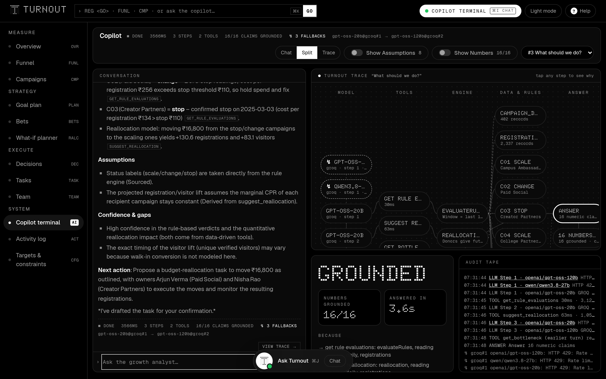
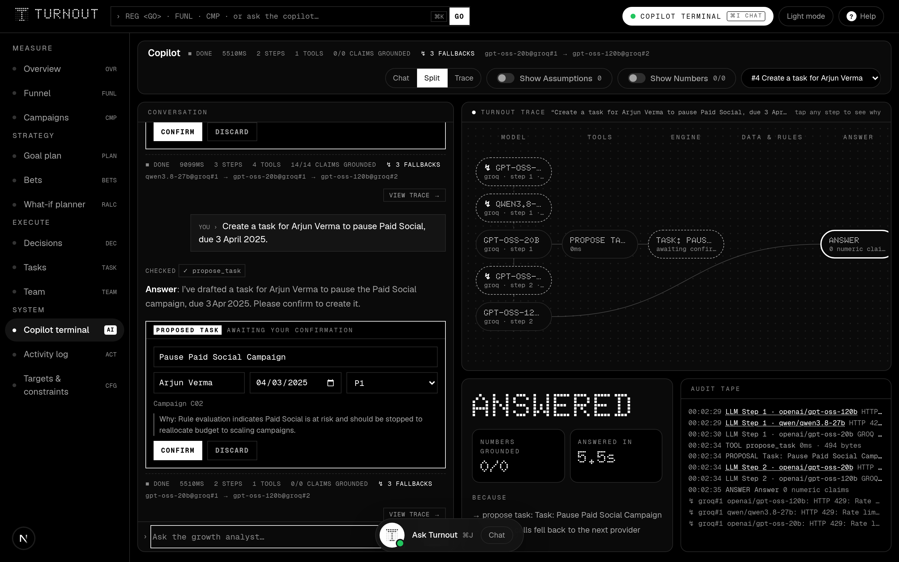
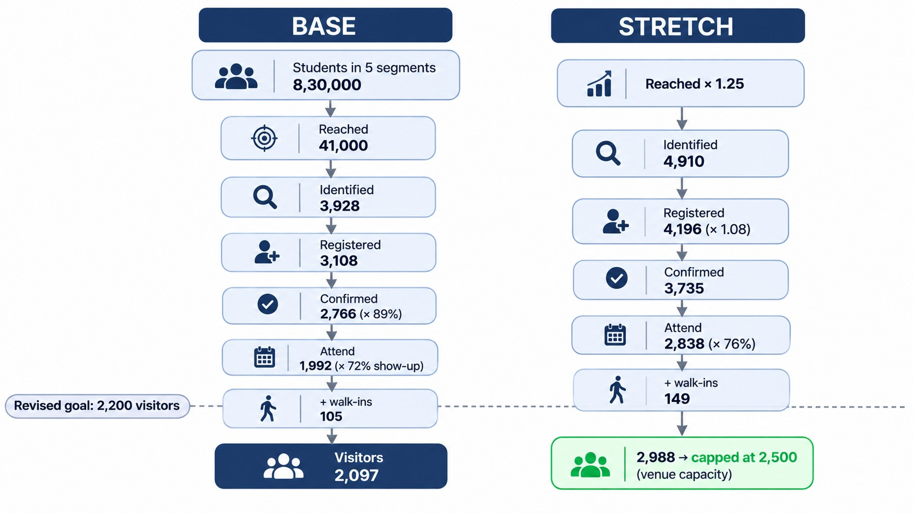
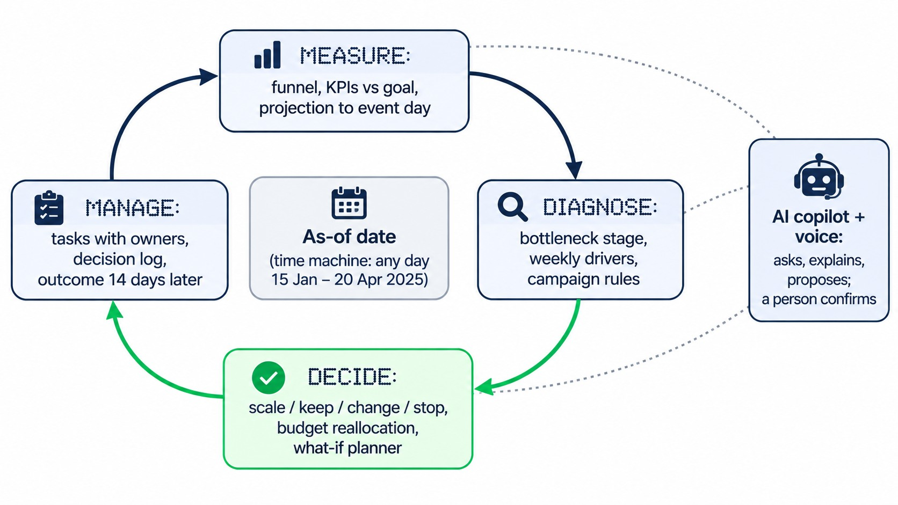
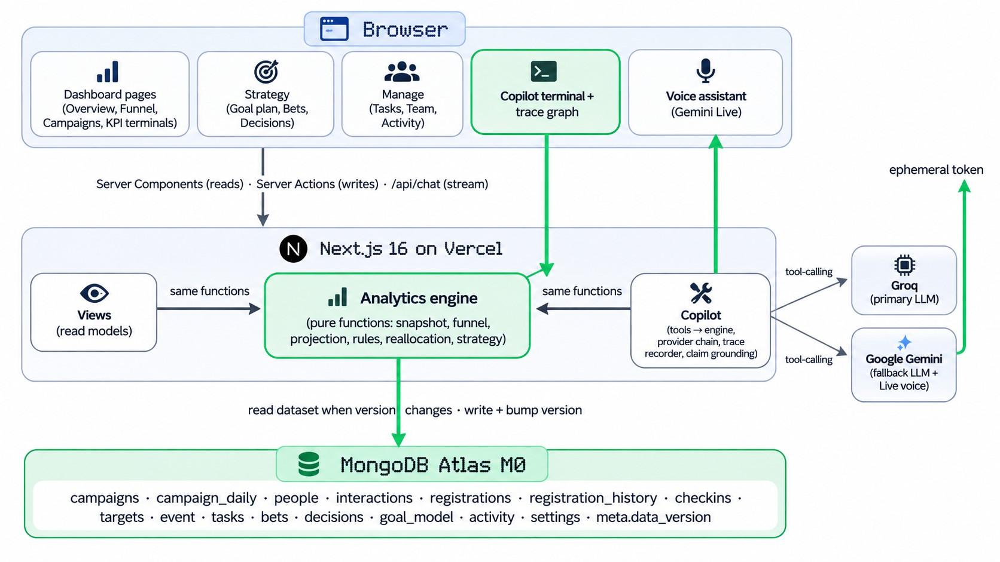
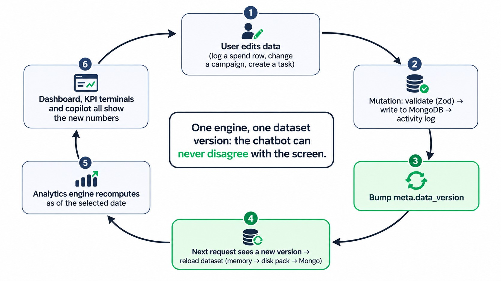
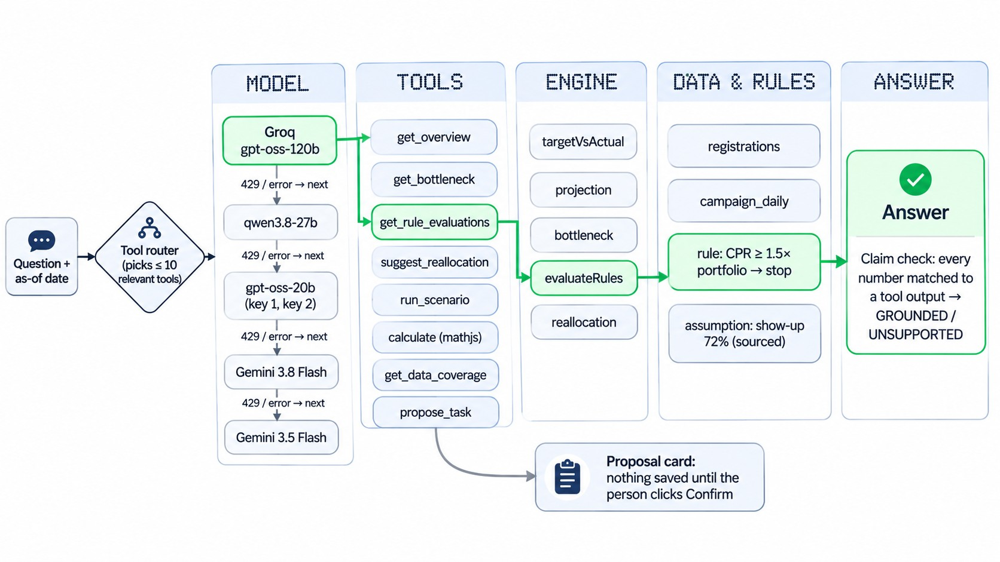

# TURNOUT

**One place to measure, diagnose, decide and manage attendee growth, with an AI analyst whose every number traces back to the data.**

RISA Growth APM assignment, Part 2 · **Challenge A: Attendee Growth** · city: **Bengaluru** · by **G L Lohith**

| | |
|---|---|
| **Live app** | _[Vercel URL: add after deploy]_ |
| **Passcode** | _[shared in the submission form]_ |
| **3-slide deck** | [Turnout-slides.pdf](Turnout-slides.pdf) (LaTeX source in `slides/`) |
| **Full write-up (26 pages, with references)** | [README.pdf](README.pdf) |

**Why Bengaluru.** Bengaluru Urban has **1,148 colleges, the most of any district in India** (Pune 517, Hyderabad 465; AISHE 2023-24). The dataset's channels (ambassadors, college partnerships, clubs, referrals) work best where many campuses sit close together, and the college count gives the goal plan a sourced starting population instead of a guess.


### 60-second reviewer tour

1. Open the live link and enter the passcode. Press anywhere on the welcome screen. A 9-step tour runs on the first visit; **Skip** is on every step, and **Help** (top right) replays it.
2. On **Overview**, click the **Decision point** preset (31 Mar 2025). The headline reads *"On pace for 1,837 visitors, 363 short of 2,200"*.
3. Click the **Registrations** card to open its terminal-style drill-down, with the goal line and forecast cone.
4. Open **Funnel** (the bottleneck is highlighted), then **Bets** (five ranked strategies judged by early signals).
5. Open **Copilot terminal** and ask, in order:
   - *Are we on track?*
   - *Why?*
   - *What should we do?*
   - *Create a task for that*
   - *What was our Instagram CTR in 2023?*

   Click any step in the trace to see its inputs.
6. Press **⌘/Ctrl + J** and say *"take me to paid social"* (needs a microphone).

---

## 1. Demo workflow

All screenshots are from the running app, as of **31 Mar 2025**, in one copilot conversation.

| # | Ask or do | What happens |
|---|---|---|
| 1 | *Are we on track?* | Registrations **at risk**: 2,337 now, 2,887 projected vs 3,200. Visitors **off track**: 1,837 projected vs 2,200. Spend under budget. |
| 2 | *Why?* | Bottleneck: identified → registered is **70.4% vs the plan-implied 88.9%**. Weakest: Creator Partners, Community Groups, Paid Social. |
| 3 | *What should we do?* | Creator Partners is a **confirmed stop** (3 Monday stop readings in a row, since 3 Mar). Paid Social (₹256 per registration, 14 days, stop line ₹110) is on its **2nd** stop reading, so it is **held**: no new spend, stopped only if the next Monday confirms. Move **₹16,800** (₹9,300 + ₹7,500) to the four cheapest campaigns: **+131 registrations, +83 visitors**. |
| 4 | *Create a task for that* | A **proposal card** appears. Nothing is written until **Confirm**; the task then shows in Tasks and in the Activity log as `copilot`. |
| 5 | Edit the data, ask again | Campaigns → Community Groups → Data: log ₹5,000 spend for 31 Mar. Its 14-day CPR goes from ₹25 to **₹103.1**; the verdict and the copilot's answer change on the next request. **Reset** restores the original data. |
| 6 | *What was our Instagram CTR in 2023?* | *"I don't have any 2023 data"*, with the real coverage (15 Jan–20 Apr 2025) and what data would be needed. |

| Step 3: recommendation, with the trace | Step 4: proposed, not created |
|---|---|
|  |  |

| Step 1: on track? | Step 6: honest about what it can't answer |
|---|---|
|  |  |

## 2. Research and data sources

Researched before building: fest attendance, the city's student base, ad costs, funnel and no-show benchmarks, and the free-tier limits of every service used. **Sponsor deal sizes were not researched**: they belong to Challenge B. Full notes, including where sources conflict: [README.pdf §3](README.pdf).

| Metric | Value | Source | Label |
|---|---|---|---|
| Colleges, Bengaluru Urban | 1,148 (most in India) | [AISHE 2023-24](https://www.dohe-education.gov.in/static/uploads/2026/07/8616f33dfee644ab6b87a2bd0658b18d.pdf) | Sourced |
| Bengaluru college students | ~8–10 lakh (8,30,000 used) | derived from AISHE | **Assumption** |
| Mood Indigo / Saarang / Oasis attendance | 1,50,000+ / 80,000+ / 8,000–10,000 | [Wikipedia](https://en.wikipedia.org/wiki/Mood_Indigo_(festival)), [IIT Madras](https://www.iitm.ac.in/happenings/press-releases-and-coverages/saarang-returns-iit-madras-8-12-jan-2026-new-experiences), [Wikipedia](https://en.wikipedia.org/wiki/Oasis_(festival)) | Sourced |
| Mood Indigo 2025 crowd crush | pre-registrations cancelled | [Careers360](https://news.careers360.com/iit-bombay-cancels-mood-indigo-pre-registrations-stops-entry-outsiders-crowd-chaos-seedhe-maut-concert-sonu-nigam-vicky-kaushal) | Sourced (why visitors are capped at capacity) |
| Meta CTR / CPC / CPL, India | 1.0–1.5% / ₹8–25 / ₹150–400 | [Owlclaw](https://owlclaw.com/benchmarks/meta-ads-benchmarks-india) | Sourced (vendor) |
| Instagram CPM, India | ₹45–350 | [Upgrowth](https://upgrowth.in/instagram-ads-pricing-india-2026/) | Sourced (vendor) |
| Free-event no-show (median) | ~28% → **show-up 72%** | [PheedLoop](https://pheedloop.com/blog/event-data-lab-report-5) | Sourced |
| Large free-event no-show | ~24% → **stretch show-up 76%** | [PheedLoop](https://pheedloop.com/blog/event-data-lab-report-5) | Sourced |
| Click → session / session → start / confirm | 70% / 15% / 90% | none found | **Assumption** |
| Sponsor deal sizes | not researched | — | Out of scope |

## 3. Assumptions

| Kind | What it is | How it's marked |
|---|---|---|
| **Original dataset** | The RISA workbook, byte-for-byte (SHA-256 checked). Every metric is computed from it. | No badge; **Reset** restores it |
| **Simulated** | Goal plan, 5 bets, decision log, 4 starter tasks, drafted by us. They change no dataset number. | `SIMULATED` badge |
| **User / copilot** | Anything created or edited in the app | `USER` / `COPILOT` badge, Activity log |
| **Assumptions** | Parameters the data can't give (below) | `Assumption` / `Sourced` label with link |

Sensitivity on 31 Mar (base: **1,837 visitors**), from the engine's scenario function:

| Assumption | Value | Why | If it moves |
|---|---|---|---|
| Show-up before the event | 72% (stretch 76%) | Sourced free-event median; the data's actual result was 77.0% | **Biggest lever: ~25.5 visitors per point.** 60% → 1,531; 50% → 1,276; 40% → 1,021 |
| Walk-ins | 5% of visitors | Actual was 125 / 2,050 = 6.1% | 0% → 1,745; 10% → 1,939 |
| Venue capacity | 2,500 (app default: total) | No field in the data | Not binding at base. As a total cap it holds stretch to 2,500; as a per-day limit it doesn't bind (2025's day 1 took 70%, so 2,988 means ≈2,090 on day 1) |
| Registration close | 11 Apr | Last registration seen 10 Apr | Each day ≈ +50 registrations |
| Rule thresholds | scale ≤ 0.8×, stop ≥ 1.5× portfolio CPR | No per-campaign cost targets in the source | Paid Social and Creator Partners stop at any multiple from 1.2× to 1.8× |
| Extra-spend efficiency | 2× recipient's CPR | Diminishing returns | Conservative: reallocation gains are understated |

**Segment overlap:** "friends of registrants" (20,000) also sit inside the campus segments, so the 8,30,000 total overcounts by at most 2.4%. The app removes this in practice, because people are deduplicated by ID and each one counts once, by registration source.

**Identified → registered:** the plan uses 79.1%, in line with 2025's full campaign (80.0%, measured to 20 Apr). The organisers' revised targets (3,600 identified → 3,200 registrations) imply 88.9%. On 31 Mar the data stood at 70.4%, which is why this is the stage bets 1–2 attack.

## 4. Calculations

Full worked examples: [README.pdf §5](README.pdf). Every figure is checked against an independent pandas computation (`tests/engine.golden.test.ts`).

**Goal plan, bottom up** (the "how high can we aim?" answer):

```
identified_s = population_s × reach_s × identify_s        registered_s = identified_s × register_s
visitors     = min( capacity, Σ registered_s × confirm × show_up ÷ (1 − walk_in_share) )
```

| | Identified | Registered | Confirmed (× 0.89) | Attend | + Walk-ins | **Visitors** |
|---|---|---|---|---|---|---|
| **Base** | 3,928 | 3,108 | 2,766 | 1,992 (× 72%) | 105 | **2,097** |
| **Stretch** (reach × 1.25, register × 1.08) | 4,910 | 4,196 | 3,735 | 2,838 (× 76%) | 149 | **2,988** (demand ceiling) |



The 2,200 goal sits between base (2,097, +2% on 2025) and the demand ceiling (2,988, +46%). The **funded plan reaches 2,282** (104% of goal, ₹120 per visitor vs 2025's ₹134), and 2,418 once the reserve follows the winners. Stretch beyond 2,500 needs the capacity lever: day-2 passes and staggered entry slots, so each day stays under 2,500.

**Projection from the data, 31 Mar:** 2,337 + 50.0/day × 11 days = **2,887 registrations** → × 83.95% confirmed × 72% show-up ÷ 0.95 = **1,837 visitors**. Stretch: 3,077 / 2,067.

**Rules (14-day CPR vs portfolio ₹73.58):**
- **Lines:** scale ≤ ₹58.86, stop ≥ ₹110.37.
- **Confirmation:** a stop is confirmed only by 3 stop readings in a row at the Monday reviews, each on ≥ 30 registrations.
- **Creator Partners:** **stop**, confirmed 3 Mar.
- **Paid Social:** ₹256, but only its 2nd reading in a row, so **change, hold new spend**. It is confirmed on 7 Apr.
- **The other five:** **scale**.

**Final result (20 Apr):** identified 3,625 / 3,600 (achieved) · registrations 2,800 / 3,200 (87.5%, missed) · visitors 2,050 / 2,200 (93.2%, missed) · spend ₹2,74,000 / ₹3,00,000.

## 5. Prioritization: RICE for planning, rules for operating

RICE = Reach × Impact × Confidence ÷ Effort.

| # | Bet | Reach | I | C | E | **RICE** | Budget | Lift (visitors) |
|---|---|---|---|---|---|---|---|---|
| 1 | Campus ambassador network | 40,000 | 2 | 0.8 | 6 | **10,667** | ₹1,00,000 | 659 |
| 2 | College club group sign-ups | 25,000 | 2 | 0.8 | 4 | **10,000** | ₹80,000 | 689 |
| 3 | Bring-3-friends referrals | 15,000 | 2 | 0.7 | 3 | **7,000** | ₹30,000 | 355 |
| 4 | Creator-led reels (test) | 80,000 | 1 | 0.4 | 5 | **6,400** | ₹20,000 | 59 |
| 5 | Paid social retargeting (test) | 1,20,000 | 0.5 | 0.4 | 4 | **6,000** | ₹15,000 | 55 |

**Money follows the ranking:**
- **Bets 1–2** get 73% of bet spend (₹1,80,000 of ₹2,45,000).
- **Bets 4–5** are capped tests that earn more only by crossing their scale line.
- **The budget:** ₹3,00,000 = bets ₹2,45,000 + always-on channels ₹30,000 + a ₹25,000 reserve for whichever bets cross their scale line.
- **Lift:** budget ÷ the channel's 2025 cost per verified visitor, with spend above the 2025 level at 2× that cost.
- **The total:** a no-bet baseline of 465 (always-on 360 + walk-ins 105) plus the bets' 1,817 gives **2,282**.

Once campaigns run, evidence replaces estimates: the CPR rules. The two frameworks agree, because the two lowest-RICE bets are the two campaigns the rules later **stop**.

**Dropped:**
- **ICE:** no reach term, and reach is what differs most between peer and media channels.
- **MoSCoW and Kano:** they don't rank within a category.
- **Many-criteria scoring:** more knobs than evidence.
- **Cost per visitor as the daily metric:** it only exists after the event.

**Constraints:**
- **Dependencies:** referrals (bet 3) need registrants from bets 1–2 first, and retargeting (bet 5) needs their landing traffic.
- **Overlaps:** clubs and friends sit inside the campus segments, so people are deduplicated by ID and attributed to one source. That way the lifts don't double-count.
- **Risks:**
  - ambassador fatigue and uneven quality;
  - a few big clubs carrying bet 2;
  - one owner (Meera Iyer) for both top bets, so Arjun Verma co-owns bet 2 (his time is freed by the smaller retargeting test);
  - reward abuse on referrals;
  - creator views that never convert;
  - weaker show-up from paid traffic.

### How we know what's working

Each bet has its own scale / change / stop lines, stored in the app (Bets page). The app judges them at every checkpoint: day 7, day 14, weekly, the 31 Mar decision point, registration close, the event, and 14 days after.

| Bet · biggest risk | Early signal | ● Scale | ◐ Change | ○ Stop (3 Monday readings in a row, each ≥ 30 regs) | 31 Mar reading |
|---|---|---|---|---|---|
| 1 Ambassadors · fatigue | CPR 14 d, regs/day 7 d | ≤ ₹50 and ≥ 8/day | ₹50–120 | ≥ ₹120 or ≤ 3/day | ● ₹35, 8.7/day |
| 2 Club sign-ups · few big clubs | CPR 14 d, confirm rate | ≤ ₹50, confirm ≥ 88% | confirm 78–88% | ≥ ₹120 or confirm ≤ 78% | ◐ ₹49, confirm 85.4% |
| 3 Referrals · reward abuse | CPR, regs/day, confirm | ≤ ₹45, ≥ 6/day, confirm ≥ 88% | in between | ≥ ₹110, ≤ 2/day or confirm ≤ 78% | ◐ ₹30, 8.7/day, confirm 82.0% |
| 4 Reels (test) · views don't convert | CPR, confirm | ≤ ₹70, confirm ≥ 88% | ₹70–130 | ≥ ₹130 or confirm ≤ 78% | ○ stopped 24 Mar (3rd Monday stop reading in a row) |
| 5 Retargeting (test) · weak show-up | CPR, confirm | ≤ ₹80, confirm ≥ 88% | ₹80–150 | ₹150, or the ₹110 portfolio line, whichever comes first | ○ stopped 17 Feb (3rd Monday stop reading in a row); its ₹15,000 test is not renewed |

- **Lesson from replaying every Monday review of 2025:**
  - A "two stop readings in a row" rule, even on ≥ 30 registrations, would have stopped **Referrals** on 3 Mar.
  - Referrals then became the cheapest bet (₹30 per registration on 31 Mar, ₹16 by 7 Apr).
  - **So a stop needs three stop readings in a row, each on ≥ 30 registrations.** Stops are sticky: once confirmed, the money moves.
  - On the 2025 data the rule stops **Retargeting** (17 Feb), **Creator Partners** (3 Mar) and **Reels** (24 Mar), and **Paid Social** a week after the decision point (7 Apr).
  - It keeps Referrals, Clubs and Ambassadors.
  - A stop reading that isn't confirmed means "change: hold new spend".
  - The app applies exactly this rule (`lib/analytics/confirm.ts`), in the campaign rules, the bet verdicts and the copilot's tools.
- **Cause, not just correlation:** holdout colleges (bet 1), a reward A/B test (bet 3) and tracked creator links (bet 4) give comparison groups. The app labels weekly drivers as association, and it measures each logged decision over the 14 days before and after.

## 6. Product and architecture



| Module | Screens | What it does |
|---|---|---|
| **Measure** | Overview, 8 KPI terminals, Funnel, Campaigns | Goal vs actual vs projection; two-layer funnel; an **as-of** time machine (any day, 15 Jan – 20 Apr 2025) |
| **Diagnose** | Funnel, "This week", Campaign detail | Bottleneck stage and weakest campaigns; weekly drivers (association, not cause) |
| **Decide** | Campaigns, What-if planner, Goal plan, Bets | Scale / keep / change / stop; reallocation; scenarios; ranked bets with early signals |
| **Manage** | Tasks, Decisions, Team, Activity, Targets | Owners and due dates; decision outcomes 14 days later; workload; change log; reset |
| **Ask** | Copilot terminal, chat (⌘I), voice (⌘J) | Grounded answers with traces; proposals that wait for a yes; navigation by voice |



**How a change reaches the analytics:** every write bumps `meta.data_version`. Each request reads only that counter and reloads the dataset when it has changed, so pages, the API and the copilot all recompute from the same data. Cold start is ~1.5 s on M0; warm pages take 0.06–0.8 s.



## 7. AI chatbot design



- **Grounded:** 24 tools call the same engine as the screens. A sandboxed `calculate` tool does all arithmetic. Every number in an answer is matched against tool output; unmatched numbers are flagged **UNSUPPORTED**, and the verdict panel says GROUNDED or CHECK.
- **Confirm before writing:** the `propose_*` tools only return drafts. **Confirm** uses the screens' write path with `actor: "copilot"`. The voice assistant asks "Shall I…?" and acts only on a clear yes.
- **Uncertainty:** before saying the data can't answer, it must call `get_data_coverage`. Answers separate evidence, labelled assumptions and confidence, and say association, not cause.
- **Follow-ups:** routing uses the last two user messages, and ambiguous names return candidates.
- **Providers:** Groq first (`gpt-oss-120b` → `qwen3.8-27b` → `gpt-oss-20b`, two keys), then Gemini `3.8-flash` → `3.5-flash`. Fallback happens per step, and every attempt shows in the trace.
- **Trace:** recorded on the server from what actually ran. It shows Model → Tools → Engine → Data & rules → Answer, and every step is clickable.
- **Voice (Gemini Live):** the same tools, plus screen tools (navigate, read the screen, show details). The browser gets a single-use token, so the key stays on the server.
- **Limits:**
  - Free-tier rate limits cause fallbacks.
  - Multi-step chat answers take ~5–13 s (voice: 1–3 s).
  - Grounding checks numbers, not reasoning.
  - A provider failure mid-stream isn't retried.

## 8. Testing

| What | Result |
|---|---|
| `npm test`: unit and golden tests (edge cases, pandas-checked engine, strategy engine, grounding, routing) | **63 / 63 pass** |
| `npm run eval`: 30 copilot questions in 11 categories, expected values computed live | **27 / 30 (90%)**; 146 / 165 numbers grounded (88.5%), latest run, after the stop-rule change. Full table: [README.pdf, Appendix A](README.pdf) |
| `scripts/onboarding-e2e.mjs`: welcome → tour → help → skip, in real Chrome | pass |
| `scripts/assistant/voice-e2e.mjs`: voice with a simulated mic: navigate, ask, propose, "no" | 5 / 5 |
| By hand | worked examples vs pandas; the data-change loop (C07 CPR ₹25 → ₹103.1); every screen on 3 dates; provider fallbacks; both themes; reset |

**Eval history:** 23/30 at first → four fixes → 29/30 → **27/30** on the latest run, after the stop rule and the tool-first change.

The three latest failures were all answered by fallback models while the main Groq model was rate-limited:
- **M1, ambiguity:** *"the partners campaign"* was answered for one campaign instead of asking which.
- **Q2:** it gave the right breakdown (40 internal + 10 staff + 10 test) but never stated the total of 60.
- **U4:** it checked data coverage but didn't plainly say the data can't explain cancellations.

The checks were not loosened to pass them.

## 9. Tools used

| Tool | Plan |
|---|---|
| Next.js 16.4 · React 19 · TypeScript | open source |
| Vercel | **Hobby (free)** |
| MongoDB Atlas | **M0 (free)** |
| Groq | **free tier**, 2 keys |
| Google AI Studio: Gemini 3.8 / 3.5 Flash, Gemini Live | **free tier** |
| Vercel AI SDK 7 · Zod 4 · mathjs · Tailwind 4 · React Flow + dagre | open source |
| React Bits (13 components) · Doto & Geist fonts | MIT + Commons Clause · SIL OFL |
| Vitest · Playwright | open source |

**Reused, modified and verified:**
- **Reused:** the Next.js scaffold, React Bits, React Flow, dagre and the fonts.
- **Modified:** every React Bits component, restyled monochrome, with a reduced-motion fallback.
- **Written:** the engine, the write path, the copilot (tools, router, provider chain, trace, grounding), the voice assistant, all pages and charts, and the tests.
- **Verified:** the engine against pandas, the eval with live expected values, the data-change loop, and voice and onboarding in a real browser.

## 10. Setup

```bash
git clone <repo> && cd turnout
npm install                  # Node 22+
cp .env.example .env         # see below
npm run seed                 # import data/original (checks SHA-256)
npm run seed:strategy        # goal plan, bets, decisions (simulated)
npm run verify-seed          # headline numbers straight from MongoDB
npm run dev                  # http://localhost:3000
```

| Variable | Purpose |
|---|---|
| `MONGODB_URI`, `MONGODB_DB` | Atlas connection, database name |
| `GROQ_API_KEY`, `GROQ_API_KEY2` | primary models |
| `GOOGLE_GENERATIVE_AI_API_KEY`, `GOOGLE_API_KEY_2` | Gemini fallback |
| `ASSISTANT_GEMINI_API_KEY` | optional key for voice |
| `ADMIN_TOKEN` | protects seed / reset endpoints |
| `APP_PASSCODE` | optional demo passcode |

- **Reset to the original data:** use any of these:
  - Targets & constraints → **Reset**;
  - `npm run seed -- --reset`;
  - `POST /api/admin/reset` with `Authorization: Bearer $ADMIN_TOKEN`.
- **Deploy:**
  1. Push to GitHub, then import the repo in Vercel and add the variables.
  2. Set Node to 22, and the Functions region to the one nearest the Atlas cluster.
  3. In Atlas, allow `0.0.0.0/0`.
  4. On a fresh database, call `POST /api/admin/seed` once.
- **Rebuild the slides:** `./slides/build.sh` (needs the `texlive/texlive` Docker image).

## 11. Known limitations and next steps

- **Simulated strategy content.** The goal plan, bets and decisions are our drafts (labelled). Decision outcomes are 14-day associations, not causal estimates.
- **Show-up before the event** is a sourced benchmark, and it is also the biggest sensitivity.
- **Free-tier limits** cause fallbacks; a mid-stream provider failure isn't retried.
- **Chat latency:** multi-step chat answers take ~5–13 s on free-tier models; voice replies in 1–3 s.
- **Grounding is numeric:** it catches invented numbers, not wrong reasoning.
- **Not built:** Challenge B (sponsorship).
- **Next:**
  - answers under 3 s;
  - persistent chat history;
  - per-campaign budget plans;
  - a cost-per-visitor rule after the event;
  - an eval set written by someone other than the builder.

## 12. Decisions I made

| Decision | Trade-off |
|---|---|
| **Challenge A over B** | The dataset is a complete person-level attendee history, so this could be built on real numbers end to end. Cost: no sponsor pipeline. |
| **Propose, never auto-execute** | The team sees exactly what will change and owns the call. Cost: one click per action. |
| **One engine for screens, API and copilot** | The chatbot can't contradict the dashboard. Cost: each new question type needs an engine function. |
| **Tools + calculator, not data in the prompt** | Exact arithmetic, traceable numbers, fits free-tier limits. Cost: slower multi-step answers. |
| **As-of replay, not "today"** | Reviewers can see the 31 March decision as it looked then, with no look-ahead. Cost: every query carries a date. |

## 13. Ownership: how I decided, tested, and what's still weak

- **Decided:** research first, written down with sources and conflicts. Every decision is logged with its date and reason. The dataset was profiled before any design, so its 11 traps became tested engine rules (all in [README.pdf](README.pdf)).
- **Tested:** in this order:
  1. independent numbers (pandas vs TypeScript);
  2. edge cases;
  3. the AI, against answers computed live;
  4. the product, in a real browser.

  Failures changed the product:
  - the eval went from 23/30, through four fixes, to 29/30;
  - the weekly replay replaced a stop rule that would have killed a winning bet;
  - a fallback model that answered without tools led to tool-first answering;
  - the voice browser test found a turn-taking race, which was fixed.

  The latest eval is 27/30.
- **Still weak:**
  - **The eval set:** I wrote all 30 questions myself, so it is a smoke test, not a benchmark.
  - **Ungrounded numbers:** about 1 in 10 numbers isn't grounded. These are flagged, not blocked.
  - **Strategy inputs:** these are my planning assumptions, and the team's own estimates should replace them.
  - **Chat latency:** multi-step chat answers are the slowest part of the app.

---

In depth: [README.pdf](README.pdf), with research and sources, the dataset profile, every calculation, the full eval table and the decisions log · Slides: [Turnout-slides.pdf](Turnout-slides.pdf)
